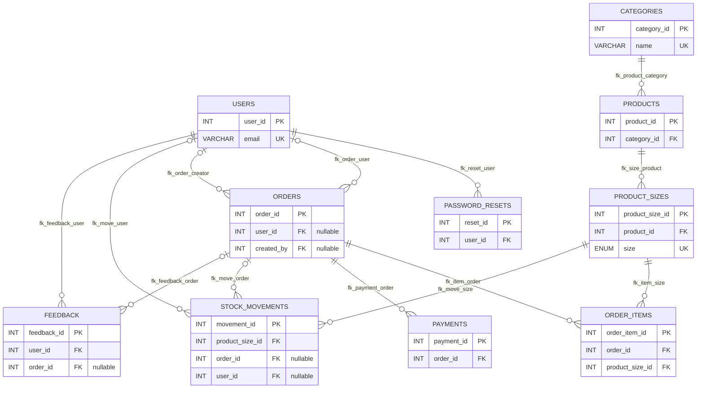

# Entity-relationship diagram

The diagram below represents every table and all thirteen foreign keys declared in `database/schema.sql`. Labels distinguish the two user references from `orders` and show nullable foreign-key relationships.

A user can have many password-reset records, customer orders, staff-created orders, stock-movement audit entries, and feedback records; the corresponding nullable foreign keys allow some orders and stock movements to have no associated user. Categories contain products, and each product has product-size inventory rows. An order has order items and may have payment and stock-movement records. Each order item refers to a product-size row, which identifies the product and size sold.
